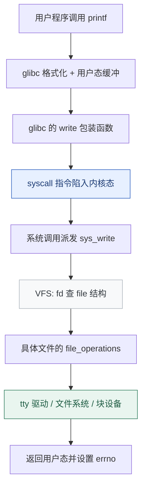

# Linux 到底是什么：内核、发行版与一次系统调用的旅程

**结论先行**：Linux 严格来说只是那个**内核**——管理 CPU、内存、设备与进程的一层特权代码。你日常用的 Ubuntu、RHEL、openEuler 是「内核 + 用户态工具链 + 包管理 + 安装器」组成的**发行版**。而 Android、ChromeOS、OpenWrt 用的是 Linux 内核，用户态却完全不是 GNU 那一套。把这三件事分清，是理解后面一切机制（容器、cgroup、性能、安全）的前提。

本篇是「Linux 原理系列」第 01 篇，接续[第 00 篇全景报告](/posts/2026-11-05-linux-os-00-panorama/)。

## 一、三种定义，三种边界

| 层次 | 指什么 | 典型例子 | 常见误用 |
| :--- | :--- | :--- | :--- |
| 狭义：内核 | kernel.org 发布的那个源码树 | 7.3.1、6.12 LTS | 把「升级 Linux」等同于换发行版 |
| 中义：GNU/Linux 发行版 | 内核 + glibc / coreutils / systemd / 包管理器 | Debian、Ubuntu、RHEL、openEuler | 把 Android 叫「Linux 发行版」 |
| 广义：内核生态 | 一切以 Linux 内核为底座的系统 | Android、ChromeOS、OpenWrt、路由器固件 | 用 Android 的份额论证「Linux 桌面很流行」 |

一个直接的推论：**容器不是轻量虚拟机**。Docker 容器里的「Ubuntu 镜像」和宿主机共享同一个内核，镜像里装的是用户态文件系统差异。所以 `uname -r` 在容器内外通常返回同一个版本，也不可能在容器里加载内核模块（除非宿主授权并已加载）。

验证一下你手上的系统究竟是哪三层：

```bash
uname -sr                    # 内核版本，例如 Linux 7.3.1
cat /etc/os-release          # 发行版身份（用户态文件，容器内会变）
cat /proc/version            # 内核构建信息：编译器、构建主机、时间
ls /boot/vmlinuz-*           # 磁盘上真正被引导的内核镜像
```

在容器里跑前三条，前两条会「分裂」——这是理解容器边界最快的实验。

## 二、用户态与内核态：一道硬件强制的边界

x86-64 上，用户进程运行在 ring 3，内核在 ring 0。用户态不能直接访问硬件、不能读写内核内存、不能随意切换页表。想让内核干活，只有几条受控入口：

- **系统调用（syscall）**：主动请求服务，`read` / `write` / `fork` / `mmap` 都走这里。
- **异常（exception）**：缺页、除零、非法指令等，被动陷入。
- **中断（interrupt）**：设备事件，异步进入。

反过来，用户态能观察内核的主要接口是三个伪文件系统：

| 接口 | 用途 | 例子 |
| :--- | :--- | :--- |
| `/proc` | 进程与内核运行态信息 | `/proc/<pid>/status`、`/proc/meminfo` |
| `/sys` | 设备、驱动、内核对象的结构化视图 | `/sys/class/net/eth0/statistics/` |
| `/dev` | 设备文件抽象 | `/dev/null`、`/dev/nvme0n1` |

这也是「一切皆文件」这句话的准确含义：**不是所有东西都是磁盘文件，而是内核把大量对象用文件描述符和 VFS 接口暴露出来**。

## 三、一次 write() 的旅程



几个容易忽略的细节：

1. **`printf` 不是系统调用**。它先在用户态做格式化与缓冲，只有缓冲区满、遇到换行（行缓冲）或进程退出时才调用 `write`。一次 `printf` 可能对应零次或多次 `write`。
2. **glibc 的 `write()` 只是一层包装**：把参数放进指定寄存器，执行 `syscall` 指令，再把内核返回值转换成 `-1 + errno` 的 libc 约定。内核自己只返回负的错误码。
3. **VFS 是关键抽象层**：`sys_write` 不关心 fd 背后是终端、普通文件还是 socket，它通过 `file->f_op->write_iter` 分派。这就是同一套 `read/write` 能操作五花八门对象的原因。
4. **有例外**：`gettimeofday`、`clock_gettime` 等高频只读调用由 **vDSO** 在用户态直接完成，不陷入内核，因此 `strace` 里看不到它们。

### 用 strace 亲眼看一遍

```bash
# Debian/Ubuntu: apt install strace；RHEL 系: dnf install strace
strace -e trace=write echo hello

# 典型输出（fd 1 是标准输出）：
# write(1, "hello\n", 6)                  = 6
# +++ exited with 0 +++
```

再加一层对照，看缓冲带来的差异：

```bash
strace -e trace=write python3 -c 'print("a"); print("b")'
```

### 写一段不依赖 libc 缓冲的裸调用

```c
/* raw-write.c —— 直接用 syscall() 触发 write，跳过 printf 的缓冲 */
#include <unistd.h>
#include <sys/syscall.h>
#include <stdio.h>

int main(void) {
    const char msg[] = "hello from raw syscall\n";
    long n = syscall(SYS_write, STDOUT_FILENO, msg, sizeof(msg) - 1);
    printf("syscall returned %ld\n", n);
    return 0;
}
```

```bash
gcc -O2 -Wall -o raw-write raw-write.c
strace -e trace=write ./raw-write
# write(1, "hello from raw syscall\n", 23) = 23
# write(1, "syscall returned 23\n", 20)     = 20
```

`SYS_write` 是架构相关的调用号（x86-64 上是 1，arm64 上不同），所以**应用代码不应硬编码调用号**，应该用 libc 包装；只有做容器 seccomp 规则、沙箱或内核实验时才需要直接面对它。这也解释了为什么 seccomp 过滤的是「系统调用号 + 参数」而不是「函数名」。

## 四、这套结构带来的四个实践结论

- **性能**：系统调用有陷入/退出开销，但真正昂贵的通常是后面的 I/O。优化方向是减少调用次数（批量写、缓冲、`io_uring`），而不是消灭 `printf`。
- **可观测性**：`strace` 看 syscall 边界，`perf` / eBPF 看内核内部，`/proc` 看状态快照。三者回答不同问题，别指望一个工具包打天下。
- **安全**：沙箱、seccomp、Landlock 都是在系统调用这道边界上做文章。理解边界在哪，才能判断一个「隔离方案」到底隔离了什么。
- **可移植性**：换成 musl（Alpine）或不同架构，用户态行为可能变化，但 syscall ABI 由内核保证长期稳定——这是容器镜像能跨发行版运行、而二进制不能随意跨 libc 的根源之一。

## 五、动手清单（十分钟）

```bash
# 1. 分清三层
uname -r; cat /etc/os-release | head -3

# 2. 数一数一个简单命令到底做了多少次系统调用
strace -c -f /bin/true

# 3. 观察 vDSO 是否存在
grep -i vdso /proc/self/maps

# 4. 从 /proc 读自己的进程状态
cat /proc/self/status | head -12

# 5. 看看内核支持哪些系统调用（部分发行版提供）
ls /usr/include/asm/unistd_64.h 2>/dev/null && grep __NR_write /usr/include/asm/unistd_64.h | head -2
```

第 2 步的 `-c` 汇总通常显示几十次调用，绝大多数来自动态链接器加载 `.so` 与运行时初始化——**「程序只有一行」和「内核只做一件事」完全是两回事**。

## 系列导航

| 篇 | 文章 |
| :--- | :--- |
| 00 | [Linux 操作系统全景：可核查的深度研究报告](/posts/2026-11-05-linux-os-00-panorama/) |
| 01 | 本篇：内核、发行版与系统调用 |
| 02 | [进程与调度：从 fork 到 EEVDF](/posts/2026-11-05-linux-os-02-process-scheduler/) |
| 基础 | [文件权限与特权提升](/posts/2026-09-14-linux-permissions-security/) · [信号机制与守护进程](/posts/2026-09-14-linux-signals/) · [网络命名空间与容器隔离](/posts/2026-09-14-linux-network-namespaces/) · [systemd 与自动化运维](/posts/2026-09-14-linux-systemd-ops/) |

下一篇进入进程与调度：为什么 `fork` 之后要立刻 `exec`，CFS 为什么在 6.6 让位给 EEVDF，以及怎么用 `pidstat` 判断一个进程到底在等 CPU 还是在等 I/O。

---

*本篇命令在 x86-64 的 GNU/Linux 发行版上验证；不同架构的系统调用号与寄存器约定不同，请勿照搬硬编码值。*
