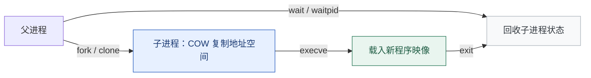
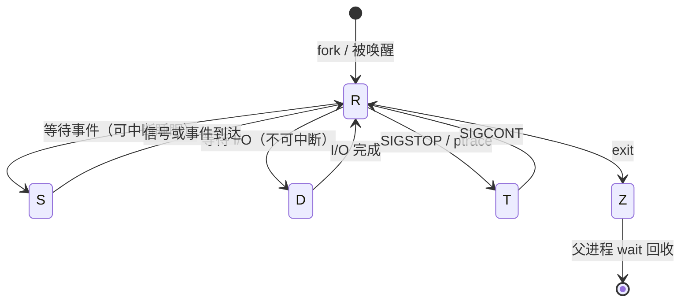

# 进程与调度：从 fork 到 EEVDF

**结论先行**：Linux 里没有「进程」和「线程」两套数据结构，只有一个 `task_struct`——区别只是 clone 时是否共享地址空间、文件描述符表与信号处理器。调度器看到的永远是「任务」。理解这一点，就能解释为什么 `ps -L` 能看到线程、为什么多线程进程的 PID 只有一个，以及为什么容器里 `nproc` 常和直觉不符。

另一条主线是调度器的换代：CFS（完全公平调度器）从 2.6.23 主导了十五年，在 **6.6（2023-10）** 被 **EEVDF** 取代公平调度核心。这不是「换个名字」，而是从「谁累计运行时间最少」变成「谁已经逾期、谁的虚拟截止时间最早」。

本篇是「Linux 原理系列」第 02 篇，接续[第 01 篇系统调用](/posts/2026-11-05-linux-os-01-kernel-syscall/)与[第 00 篇全景报告](/posts/2026-11-05-linux-os-00-panorama/)。

## 一、fork → exec → wait：三段式



- **`fork()`**：早期是真复制整个地址空间，代价高。现代内核用**写时复制（COW）**：父子先共享同一批物理页并标记为只读，任一方写入时触发缺页异常才复制那一页。所以 fork 之后立刻 exec 是很便宜的路径。
- **`execve()`**：不创建新进程，而是把当前任务的地址空间整体替换为新程序（新代码段、堆、栈、重新映射动态链接器）。PID 不变。
- **`wait()`**：子进程退出后保留一个极小的 `task_struct` 与退出码，等父进程回收。不回收就是**僵尸进程（Z）**——它不占内存和 CPU，但占 PID 表项。

这也是 `system()` 与 `posix_spawn()` 的差异来源：后者在 glibc 里可以用 `clone(CLONE_VM|CLONE_VFORK)` 避免复制大进程的地址空间，对「一个占用几十 GB 内存的进程要启动外部命令」这类场景很关键。

关于信号的传递、SIGTERM 与 SIGKILL 的差别、优雅退出流程，本站已有专文：[信号机制与守护进程的生与死](/posts/2026-09-14-linux-signals/)。

## 二、状态机：D 状态为什么 kill 不掉



| 状态 | 含义 | 运维含义 |
| :--- | :--- | :--- |
| R | 可运行：正在 CPU 上或在运行队列 | 注意：R 不等于「正在跑」，也可能在排队 |
| S | 可中断睡眠 | 正常等待 socket、定时器、锁 |
| D | 不可中断睡眠 | 通常在等内核 I/O 路径完成，**不响应信号，SIGKILL 也杀不掉** |
| T | 被停止（作业控制 / 调试器） | `SIGCONT` 恢复 |
| Z | 僵尸，等待父进程回收 | 大量 Z 要查父进程，不是查子进程 |
| I | 空闲内核线程 | `ps` 里常见，别误判为卡死 |

两个实战推论：

1. **load average 包含 R 和 D 状态的任务**。所以 NFS 挂载点挂掉、磁盘故障时的高 load，并不代表 CPU 忙。看到 load 高先跑 `ps -eo pid,stat,wchan:32,comm | grep -E ' R|D'`，再看 CPU 使用率。
2. **D 状态的正确处置是找底层依赖**（存储、网络文件系统、驱动），不是反复 `kill -9`。这一条在[崩溃归因五层收敛法](/posts/2026-11-03-crash-analysis-five-layers/)里也有对应层次。

## 三、CFS 到 EEVDF：公平的定义变了

CFS 的思路很好懂：给每个任务记一个**虚拟运行时间 `vruntime`**（实际运行时间按 nice 权重折算），每次挑 `vruntime` 最小的任务跑。高 nice（低优先级）任务虚拟时间涨得快，自然少跑。它简单、稳定，但有两个长期痛点：对**延迟敏感型任务**不够友好（唤醒后仍要等红黑树里更靠前的任务），以及 nice 值在负载复杂时语义不够精确。

**EEVDF**（Earliest Eligible Virtual Deadline First，6.6 起取代 CFS 核心）把问题换成「资格 + 截止时间」：

| 概念 | 含义 |
| :--- | :--- |
| lag（滞后量） | 任务「应得的时间 − 实际得到的时间」。为正表示欠了它，越大越有资格运行 |
| eligible（合格） | lag ≥ 0 的任务才进入候选；避免刚被优待过的任务继续抢 CPU |
| virtual deadline | 按权重与请求的时间片算出的虚拟截止时间，合格者中挑最早的 |
| 时间片 / 抢占 | 7.0 起默认启用 lazy preemption，减少不必要的抢占开销 |

一个直观差别：CFS 问的是「谁跑得最少」，EEVDF 问的是「谁被欠得最多、且最紧急」。对交互进程、短请求和需要低尾延迟的服务，这套模型更容易给出可预期的结果。

**别误读**：EEVDF 换的是普通任务（SCHED_OTHER / SCHED_NORMAL）的公平调度核心，不意味着 CFS 代码一夜消失，也不等于实时调度类被替换。实时类仍是 `SCHED_FIFO` / `SCHED_RR` / `SCHED_DEADLINE`；`PREEMPT_RT` 的关键部分于 6.12 进入主线，但「能编译实时抢占」与「满足硬实时 deadline」是两件事。

## 四、优先级、cgroup 与常见的失效场景

```bash
# nice：用户态改普通任务的权重（-20 最高，19 最低）
nice -n 10 ./batch-job.sh
renice -n 5 -p 12345

# 实时调度类：谨慎，配置错误可以把 CPU 打满导致系统不响应
chrt -f -p 50 12345

# cgroup v2：按 CPU 权重或硬上限约束一组进程
cat /sys/fs/cgroup/cpu.max              # 例如 "max 100000" 表示无上限
cat /sys/fs/cgroup/cpu.weight           # 默认 100，范围 1–10000
```

三个高频误判：

- **nice 在 cgroup 硬上限下几乎无效**：组已经撞到 `cpu.max` 上限时，组内调 nice 只是重新分配那点配额，不会变快。
- **容器里看到的 CPU 数量可能是宿主机的**：`nproc` 通常看的是亲和性掩码，配额限制要看 `cpu.max` 与 `cpu.stat` 的 `nr_throttled`。这是「容器里明明 4 核却跑不满」的常见原因。
- **iowait 高 ≠ 磁盘一定是瓶颈**：它表示 CPU 空闲且有任务在等 I/O，可能是网络文件系统、慢盘，也可能是某个驱动路径卡住。要结合 `iostat`、`pidstat -d` 一起看。

## 五、用 pidstat 区分「等 CPU」和「等 I/O」

```bash
# 造两类负载（在测试机上做，别在生产环境）
yes > /dev/null &                        # CPU 密集
dd if=/dev/zero of=/tmp/lx-iotest bs=1M count=512 conv=fsync &   # I/O 密集

# 每秒采样一次，共 5 次：-u 看 CPU，-w 看上下文切换
pidstat -u -w 1 5

# 单进程的调度细节（需 root 或同用户）
cat /proc/<pid>/sched | head -20

# 收尾
kill %1 %2 2>/dev/null; rm -f /tmp/lx-iotest
```

`pidstat -u` 的输出怎么读：

| 列 | 含义 | 判断 |
| :--- | :--- | :--- |
| `%usr` / `%system` | 用户态 / 内核态 CPU | `%system` 高常指向 syscall、锁竞争或内核路径开销 |
| `%guest` | 虚拟机里运行的时间 | 宿主机视角才常见 |
| `%wait` | 任务在运行队列等 CPU 的时间 | **高 = CPU 不够或配额被限**，对应 R 状态积压 |
| `%CPU` | 总 CPU 占用 | 多核可超过 100% |

一条实用的判别链：`%wait` 高 + load 高 → 查 CPU 配额与并行度；`%wait` 低但延迟高 + D 状态多 → 查 I/O 与内核等待路径；`%system` 高 + 上下文切换暴涨 → 查锁、线程数或 syscall 频率（`strace -c` / `perf`）。

## 六、把机制串起来

[第 01 篇](/posts/2026-11-05-linux-os-01-kernel-syscall/)讲的那道 syscall 边界，在这里变成了调度器的输入：一次阻塞 `read` 会把任务从 R 挪到 S 或 D 并让出 CPU；I/O 完成中断唤醒任务后，调度器再按 EEVDF 的资格与截止时间决定何时让它回到 CPU。容器资源限制（cgroup v2）则在这之上再加一层配额——这也是后续[网络命名空间与容器隔离](/posts/2026-09-14-linux-network-namespaces/)与 cgroup 专题的衔接点。

## 系列导航

| 篇 | 文章 |
| :--- | :--- |
| 00 | [Linux 操作系统全景：可核查的深度研究报告](/posts/2026-11-05-linux-os-00-panorama/) |
| 01 | [Linux 到底是什么：内核、发行版与一次系统调用的旅程](/posts/2026-11-05-linux-os-01-kernel-syscall/) |
| 02 | 本篇：进程与调度 |
| 03 | [内存管理：虚拟内存、页表与 OOM](/posts/2026-11-05-linux-os-03-memory-management/) |
| 04 | [VFS 与文件系统：一次写盘的完整路径](/posts/2026-11-05-linux-os-04-vfs-filesystems/) |
| 05 | [网络栈与 eBPF：从 sk_buff 到可编程内核](/posts/2026-11-05-linux-os-05-network-ebpf/) |
| 06 | [cgroup v2 与容器资源边界](/posts/2026-11-05-linux-os-06-cgroup-v2/) |
| 07 | [启动流程与内核开发：从 UEFI 到第一个补丁](/posts/2026-11-05-linux-os-07-boot-and-kernel-dev/) |
| 08 | [性能观测与调优：USE 方法与四层瓶颈判别](/posts/2026-11-05-linux-os-08-performance-observability/) |
| 基础 | [文件权限与特权提升](/posts/2026-09-14-linux-permissions-security/) · [信号机制与守护进程](/posts/2026-09-14-linux-signals/) · [网络命名空间与容器隔离](/posts/2026-09-14-linux-network-namespaces/) · [systemd 与自动化运维](/posts/2026-09-14-linux-systemd-ops/) |

下一篇进入[内存管理：虚拟内存、页表与 OOM](/posts/2026-11-05-linux-os-03-memory-management/)：虚拟地址空间、页表与缺页、page cache 与回收，以及 OOM killer 到底按什么规则挑进程。

---

*调度器行为随内核版本演进：本文以 Linux 6.6 之后的 EEVDF 主线为准；`chrt` 与实时调度类请在测试环境验证后再用于生产。*
