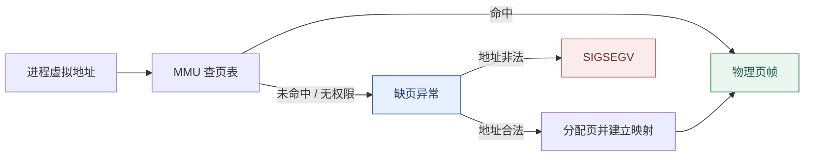
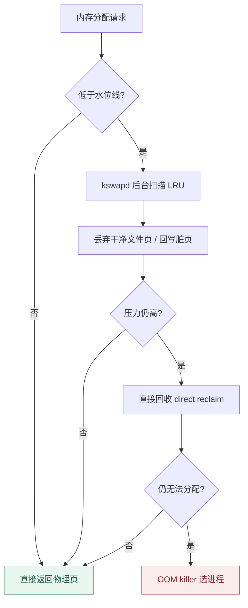

# 内存管理：虚拟内存、页表与 OOM

**结论先行**：Linux 内存管理做三件事——给每个进程一个独立的虚拟地址空间、按需分配物理页、在压力到来时回收。由此推出两条最实用的判断：**`free` 里 available 很小不代表内存不够**（多半是 page cache 占着），**OOM killer 出现也不等于「物理内存用尽」**（容器里往往只是撞到了 cgroup 的 `memory.max`）。

本篇是「Linux 原理系列」第 03 篇，接续[第 01 篇的系统调用边界](/posts/2026-11-05-linux-os-01-kernel-syscall/)与[第 02 篇的调度状态机](/posts/2026-11-05-linux-os-02-process-scheduler/)。

## 一、虚拟地址空间：进程看到的不是物理内存

每个进程都以为自己独占一整块连续地址空间，实际由**页表**把虚拟页映射到零散的物理页帧，MMU 与 TLB 负责翻译与缓存。内核空间在所有进程的页表里映射同一份内核映像，用户态不可见。



看一眼进程的地址空间布局：

```bash
cat /proc/self/maps | head -20          # VMA 列表：代码段、堆、栈、mmap 区、共享库
cat /proc/self/smaps_rollup             # 汇总：RSS、PSS、Swap、私有/共享
pmap -x <pid>                           # 逐段 RSS / 脏页
```

几个容易混淆的量：

| 量 | 含义 |
| :--- | :--- |
| VSZ / VIRT | 虚拟地址空间大小，包含未映射、未驻留的部分，**不代表占用内存** |
| RSS | 当前驻留物理页总和，共享库会被多个进程重复计入 |
| PSS | 按比例分摊共享页后的占用，多进程场景更接近真实开销 |
| USS | 进程独占的私有驻留页，判断「杀掉它能救回多少」最有用 |

## 二、缺页：三种完全不同的代价

缺页异常不都是错误，它是**按需分配**的实现机制。

```bash
/usr/bin/time -v ./your-program | grep -E "Major|Minor|Maximum resident"
ps -o pid,min_flt,maj_flt,cmd -p <pid>
```

| 类型 | 触发原因 | 代价 |
| :--- | :--- | :--- |
| minor fault | 页已在 page cache 或只需建映射（如首次写 COW 页） | 微秒级，通常无害但频率高会吃 CPU |
| major fault | 需要从磁盘/swap 读入（首次加载代码页、mmap 文件） | 毫秒级，是启动慢与卡顿的常见原因 |
| invalid fault | 访问未映射或越权地址 | `SIGSEGV`，程序 bug |

由此得到一条实用结论：**进程刚启动时大量 major fault 属正常预热**；稳定运行后仍持续 major fault，多半是内存不足导致代码页反复被回收，或 mmap 的随机读放大。

## 三、分配器：buddy、SLUB 与 malloc 不在同一层

- **伙伴系统（buddy）**：以物理页（通常 4 KiB）为单位管理连续页块，解决外碎片；支持高阶分配与透明大页（THP）。
- **SLUB**：在伙伴系统之上做小对象缓存，`kmalloc` / `kmem_cache` 走这里；`/proc/slabinfo` 可看。
- **vmalloc**：需要虚拟连续但物理可不连续的大块内核内存。
- **用户态 malloc**：这是 **glibc/musl 的堆管理器**，不是系统调用。它用 `brk` 或 `mmap` 向内核要一大块，再在用户态切分；`free()` 通常只是归还给分配器的 arena，**不会立即还给内核**。所以「程序 free 了但 RSS 没降」是正常现象。

诊断内存泄漏时要先分清层级：是分配器 arena 没释放、进程 VMA 持续增长，还是内核 slab/page cache 增长。用 `smaps_rollup` + `pmap` 看进程侧，用 `/proc/meminfo` 的 `Slab` / `SUnreclaim` 看内核侧。

## 四、page cache 与回收：available 为什么不是「空闲」

读写文件先经过 **page cache**，内核把空闲内存尽量用来缓存文件页。因此：

```bash
free -h
#               total        used        free      shared  buff/cache   available
# Mem:            15Gi       4.2Gi       1.1Gi       ...      9.7Gi        10Gi
```

这里的 `buff/cache` 是**可回收**的，`available` 才是内核估算的「还能给新进程用多少」。看到 `free` 很小就紧张，是运维里最常见的误判。

回收路径大致是：后台 `kswapd` 在达到水位线时扫描 LRU 链表 → 干净的 file-backed 页直接丢弃 → 脏页先回写 → 匿名页换出到 swap → 压力继续升高则触发**直接回收**（进程在分配路径上同步等回收，表现为延迟尖刺）→ 最后才是 OOM killer。



两个版本要点：**MGLRU（multi-gen LRU）于 6.1 合入**，用代际划分替代传统双链 active/inactive 扫描，在内存压力下表现更稳；**PSI（pressure stall information）** 则给出了比「用了多少」更有解释力的指标：

```bash
cat /proc/pressure/memory    # some / full 的 10s、60s、300s 停滞占比
cat /proc/pressure/cpu
cat /proc/pressure/io
```

`echo 3 > /proc/sys/vm/drop_caches` 常被当作「释放内存」的万能药，实际只是丢弃干净缓存页，会**主动制造后续 major fault**，生产环境不要当常规操作。

## 五、OOM killer：它到底按什么挑人

OOM 是回收全部失败后的兜底，不是「内存满了」的同义词。内核按 `oom_score`（综合驻留页、子进程、运行时间、nice 与 `oom_score_adj`）挑分数最高的进程杀掉，并在内核日志留下完整现场。

```bash
dmesg -T | grep -i -A12 "out of memory"     # 关键证据：谁被杀、各进程 oom_score、cgroup 路径
cat /proc/<pid>/oom_score
echo -500 > /proc/<pid>/oom_score_adj       # 降低被杀概率，范围 -1000 ~ +1000

# cgroup v2 侧（容器 OOM 更常见的原因）
cat /sys/fs/cgroup/memory.max
cat /sys/fs/cgroup/memory.current
cat /sys/fs/cgroup/memory.events           # oom / oom_kill 计数
cat /sys/fs/cgroup/cgroup.events           # populated / frozen
```

**容器场景的关键区别**：宿主机还剩几十 GB，容器里的进程照样会被 OOM kill——因为限额是 cgroup 的 `memory.max`，OOM 发生在那一层，`memory.events` 的 `oom_kill` 会递增。`memory.oom.group=1` 可以让整组进程一起被处理，避免只杀掉主进程留下半死不活的服务。这部分在[第 06 篇 cgroup v2](/posts/2026-11-05-linux-os-06-cgroup-v2/)会展开。

## 六、判别链：从现象到指标

| 现象 | 先看 | 含义 |
| :--- | :--- | :--- |
| `free` 显示几乎用满 | `available` 与 `/proc/pressure/memory` | available 大、PSI 低 = 缓存占满，正常 |
| 延迟周期性尖刺 | `vmstat 1` 的 `si/so`、`sar -B 1` 的 `pgscan/s` | 持续换入换出或直接回收 |
| 容器进程突然消失 | `dmesg -T`、`memory.events` | 区分宿主机 OOM 与 cgroup OOM |
| RSS 不随 free 下降 | `smaps_rollup`、`pmap -x` | 用户态分配器保留 arena，不一定泄漏 |
| 内核内存持续增长 | `/proc/meminfo` 的 `Slab`/`SUnreclaim`、`/proc/slabinfo` | 内核对象泄漏或 slab 缓存膨胀 |
| 启动慢 | `time -v` 的 major fault | 代码页/数据页首次加载或反复回收 |

一轮最小化的采样：

```bash
free -h; cat /proc/pressure/memory
vmstat 1 5                 # si/so 是否非零、free/buff/cache 变化
pidstat -r 1 5             # 逐进程 minflt/s、majflt/s、RSS
sar -B 1 5                 # pgpgin/s、pgpgout/s、pgscan/s、%vmeff
```

## 七、三条实践原则

1. **先看压力再看用量**：PSI 与 major fault 比「剩余内存百分比」更能反映用户感受。
2. **先定界再动手**：区分进程堆、page cache、slab、cgroup 限额四层，再做调参；盲目改 `vm.swappiness` 或关 swap 常让情况更糟。
3. **容器里以 cgroup 指标为准**：`memory.current` / `memory.max` / `memory.events` 是判断容器 OOM 的唯一可靠证据。

下一篇进入 [04 · VFS 与文件系统](/posts/2026-11-05-linux-os-04-vfs-filesystems/)：一次 `write()` 落到磁盘前要经过哪些层，ext4 / XFS / Btrfs 该怎么选，以及 `df` 和 `du` 为什么经常对不上。

## 系列导航

- [00 · Linux 操作系统全景：可核查的深度研究报告](/posts/2026-11-05-linux-os-00-panorama/)
- [01 · Linux 到底是什么：内核、发行版与一次系统调用的旅程](/posts/2026-11-05-linux-os-01-kernel-syscall/)
- [02 · 进程与调度：从 fork 到 EEVDF](/posts/2026-11-05-linux-os-02-process-scheduler/)
- [03 · 内存管理：虚拟内存、页表与 OOM](/posts/2026-11-05-linux-os-03-memory-management/)（本篇）
- [04 · VFS 与文件系统：一次写盘的完整路径](/posts/2026-11-05-linux-os-04-vfs-filesystems/)
- [05 · 网络栈与 eBPF：从 sk_buff 到可编程内核](/posts/2026-11-05-linux-os-05-network-ebpf/)
- [06 · cgroup v2 与容器资源边界](/posts/2026-11-05-linux-os-06-cgroup-v2/)
- [07 · 启动流程与内核开发：从 UEFI 到第一个补丁](/posts/2026-11-05-linux-os-07-boot-and-kernel-dev/)
- [08 · 性能观测与调优：USE 方法与四层瓶颈判别](/posts/2026-11-05-linux-os-08-performance-observability/)
- 基础篇：[文件权限与特权提升](/posts/2026-09-14-linux-permissions-security/) · [信号机制与守护进程](/posts/2026-09-14-linux-signals/) · [网络命名空间与容器隔离](/posts/2026-09-14-linux-network-namespaces/) · [systemd 与自动化运维](/posts/2026-09-14-linux-systemd-ops/)

---

*命令输出因内核版本、cgroup 版本与发行版而异；`echo ... > /proc/sys/` 与 `drop_caches` 类操作请在测试环境验证后再用于生产。*
