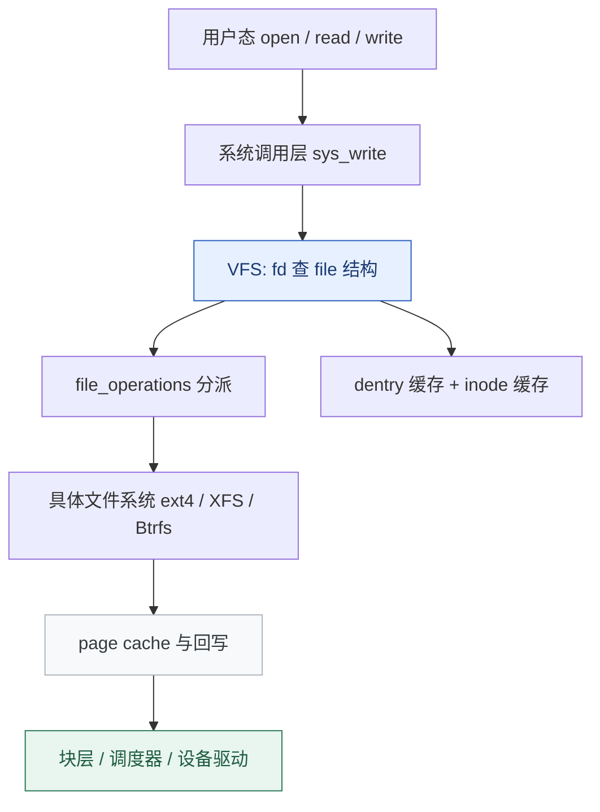

# VFS 与文件系统：一次写盘的完整路径

**结论先行**：`write()` 返回成功，通常只表示数据进了 **page cache**，并不代表已经落盘。VFS 的价值在于让同一套 `open/read/write` 能操作普通文件、管道、socket、设备与伪文件系统；而文件系统选型的关键从来不是跑分，而是**崩溃一致性模型、快照与校验能力、扩容/修复工具链，以及和你的 I/O 模式是否匹配**。

本篇是「Linux 原理系列」第 04 篇，承接[第 01 篇的系统调用链](/posts/2026-11-05-linux-os-01-kernel-syscall/)与[第 03 篇的 page cache 回收](/posts/2026-11-05-linux-os-03-memory-management/)。

## 一、四层抽象：VFS 到底抽象了什么



| 对象 | 作用 | 观察方式 |
| :--- | :--- | :--- |
| superblock | 一个已挂载文件系统实例的元数据总入口 | `findmnt`、`stat -f` |
| inode | 文件的身份与元数据（权限、大小、时间戳、块指针），**不含文件名** | `stat`、`ls -i`、`df -i` |
| dentry | 路径名到 inode 的映射与缓存，加速路径解析 | `/proc/sys/fs/dentry-state` |
| file | 一次打开的上下文：当前偏移、访问标志、操作函数表 | `/proc/<pid>/fd/` |

由此能解释几个日常现象：

- **硬链接**是同一个 inode 多了个目录项，所以不能跨文件系统、不能链目录；`ls -i` 能看到相同 inode 号。
- **软链接**是独立 inode，内容是一段路径字符串，目标删除即失效。
- **删除文件后空间不释放**：目录项没了，但仍有进程持有 fd，inode 与数据块还在。`df` 仍显示占用，`du` 却找不到文件——用 `lsof +L1` 找这类「已删除但仍打开」的文件，重启持有者或让其关闭 fd 才会释放。
- **`df -h` 与 `df -i` 是两种耗尽**：前者看数据块，后者看 inode。海量小文件场景常常空间还剩很多、inode 先耗尽，`touch` 报 "No space left on device"。

## 二、从 write 到磁盘：缓存、回写与持久化

一次普通 `write` 的典型路径是：用户缓冲区 → 内核 page cache 标记脏页 → 返回。之后由回写线程（writeback）按脏页比例、时间或显式调用刷到块层。

```bash
# 显式持久化（数据库的正确性依赖这一步）
fsync /var/lib/db/datafile.x         # 部分系统提供该命令行工具
sync                                  # 全局刷脏页，代价大且不保证按应用顺序

# 内核侧脏页参数（不要随意改，先测）
sysctl -a | grep -E "vm.dirty_(ratio|background_ratio|expire_centisecs|writeback_centisecs)"
```

| 接口 | 语义 | 适用场景 |
| :--- | :--- | :--- |
| `write()` | 数据进 page cache 即返回 | 通用 |
| `fsync()` / `fdatasync()` | 等待该文件数据（及必要元数据）落盘 | 数据库 WAL、配置持久化 |
| `O_DIRECT` | 绕过 page cache 直接 I/O（仍需对齐） | 数据库自建缓存，避免双重缓存 |
| `O_SYNC` | 每次写都同步落盘 | 正确性优先、吞吐不敏感 |
| `sync_file_range()` | 精细控制回写范围 | 批量导入后的分段刷盘 |

**断电一致性**就在这里分叉：ext4 的 journal（默认 ordered 模式）保护元数据，XFS 用元数据日志加延迟分配，Btrfs 用 CoW 保证写时不覆盖旧数据。日志/屏障（barrier、FUA）被禁用或存储谎报刷盘完成，都会让「fsync 成功」变成虚假承诺——这也是数据库在云盘上必须验证 `fsync` 行为的原因。

## 三、主流文件系统怎么选

| 文件系统 | 模型 | 强项 | 注意事项 |
| :--- | :--- | :--- | :--- |
| ext4 | 日志（journal） | 默认、工具链最成熟、`e2fsck` 可靠、通用 | 单文件/单目录规模上限，无内建快照 |
| XFS | 元数据日志 + 延迟分配 | 大文件、高并发顺序写、在线扩容 `xfs_growfs` | **不能缩容**；`xfs_repair` 需卸载；7.0 起加入自愈能力 |
| Btrfs | 写时复制（CoW） | 快照、子卷、数据校验、内建多盘、在线缩扩容 | 数据库类随机写会放大写；RAID5/6 成熟度需单独评估 |
| ZFS | CoW + 完整存储栈 | 校验、快照、ARC 缓存 | 许可与 GPL 不兼容，**不在主线内核**，需树外模块 |
| overlayfs | 联合挂载 | 容器镜像分层 | 首次改写触发 copy-up，大文件代价明显 |
| tmpfs / proc / sysfs | 内存 / 伪文件系统 | 快、内核状态接口 | tmpfs 计入内存压力，重启丢失 |

选型的三个真实约束：

1. **I/O 模式**：大量小随机写（数据库）与顺序大文件（对象存储、日志归档）不在同一个最优解上。
2. **运维能力**：能否在线扩容、能否缩容、修复工具是否可靠、备份能否用快照一致性完成。
3. **团队熟悉度**：出故障时能不能在半小时内正确跑完检查与修复，比理论吞吐重要得多。

## 四、overlayfs 与容器镜像

容器镜像的层就是 overlayfs 的 `lowerdir`（只读层）叠加 `upperdir`（可写层）与 `workdir`。读文件从上层往下找；写只读层里的文件时触发 **copy-up**——把整个文件复制到可写层再改。

实践含义：

- 在容器里就地修改一个大文件（日志、数据库文件）代价高，应写挂载卷（volume）。
- 镜像层数多会增加路径解析开销，但通常不是瓶颈；真正的瓶颈是 copy-up 与卷的 I/O 能力。
- `df` 在容器里看到的是 overlay 挂载，容量取决于宿主机 backing fs，与[第 06 篇 cgroup 资源限额](/posts/2026-11-05-linux-os-06-cgroup-v2/)是两回事。

```bash
findmnt -T /                          # 当前根挂载的文件系统与选项
cat /proc/self/mountinfo | head -15  # 挂载点、父子关系、挂载 namespace 内可见性
mount | grep overlay | head -3       # 容器宿主侧常见的 overlay 挂载
```

mount namespace 让不同容器看到各自的挂载树，这部分机制已有专文：[网络命名空间与容器隔离](/posts/2026-09-14-linux-network-namespaces/)（同属 namespace 家族）。

## 五、观测工具与常见陷阱

```bash
df -h; df -i                    # 数据块 vs inode
du -sh /var/log/* 2>/dev/null   # 按目录统计（可能比 df 小很多）
lsof +L1                        # 已删除但仍被打开的文件
iostat -x 1                     # await、%util、r/s、w/s（%util 对 SSD/NVMe 解释力有限）
lsblk -f                        # 设备、文件系统类型、UUID
findmnt -no SOURCE,TARGET,FSTYPE,OPTIONS
stat -f /var/lib/db             # 文件系统级统计
```

| 陷阱 | 正确解读 |
| :--- | :--- |
| `df` 满但 `du` 加起来远小于它 | 查 `lsof +L1`（已删未释放）与保留块（ext 系列的 root 预留） |
| 写入很快但断电丢数据 | 检查应用是否调用 `fsync`、存储是否正确处理 flush/FUA |
| `iostat %util` 接近 100% | 对机械盘是饱和信号；对 NVMe 多队列设备不代表瓶颈，要看 await 与 IOPS |
| 容器里磁盘"没有空间" | 区分镜像层配额、卷所在文件系统、宿主机磁盘三类限额 |
| 定期 `fstrim` 后性能变化 | SSD/NVMe 的 TRIM 与文件系统 discard 策略，建议周/月级定时而非 mount 时同步 discard |

关于修复工具：`e2fsck` 与 `xfs_repair` 都要求**文件系统未挂载或只读挂载**，务必先卸载并从 Live 环境操作；Btrfs 的 `btrfs scrub` 可在线做校验扫描。任何修复前先做镜像或快照。

## 六、把这条链路串起来

[第 01 篇](/posts/2026-11-05-linux-os-01-kernel-syscall/)的 `sys_write` 在这里落到了 VFS 分派；[第 03 篇](/posts/2026-11-05-linux-os-03-memory-management/)的 page cache 正是 `write` 快速返回与回收压力的共同来源；而 `fsync` 触发的回写最终进入块层，成为[第 08 篇性能观测](/posts/2026-11-05-linux-os-08-performance-observability/)里 I/O 瓶颈判别的关键一环。

## 系列导航

- [00 · Linux 操作系统全景：可核查的深度研究报告](/posts/2026-11-05-linux-os-00-panorama/)
- [01 · Linux 到底是什么：内核、发行版与一次系统调用的旅程](/posts/2026-11-05-linux-os-01-kernel-syscall/)
- [02 · 进程与调度：从 fork 到 EEVDF](/posts/2026-11-05-linux-os-02-process-scheduler/)
- [03 · 内存管理：虚拟内存、页表与 OOM](/posts/2026-11-05-linux-os-03-memory-management/)
- [04 · VFS 与文件系统：一次写盘的完整路径](/posts/2026-11-05-linux-os-04-vfs-filesystems/)（本篇）
- [05 · 网络栈与 eBPF：从 sk_buff 到可编程内核](/posts/2026-11-05-linux-os-05-network-ebpf/)
- [06 · cgroup v2 与容器资源边界](/posts/2026-11-05-linux-os-06-cgroup-v2/)
- [07 · 启动流程与内核开发：从 UEFI 到第一个补丁](/posts/2026-11-05-linux-os-07-boot-and-kernel-dev/)
- [08 · 性能观测与调优：USE 方法与四层瓶颈判别](/posts/2026-11-05-linux-os-08-performance-observability/)
- 基础篇：[文件权限与特权提升](/posts/2026-09-14-linux-permissions-security/) · [信号机制与守护进程](/posts/2026-09-14-linux-signals/) · [网络命名空间与容器隔离](/posts/2026-09-14-linux-network-namespaces/) · [systemd 与自动化运维](/posts/2026-09-14-linux-systemd-ops/)

---

*本文的文件系统特性以主线内核长期支持的功能为准；发行版默认参数、ZFS/树外模块与云盘行为请按实际环境验证。*
