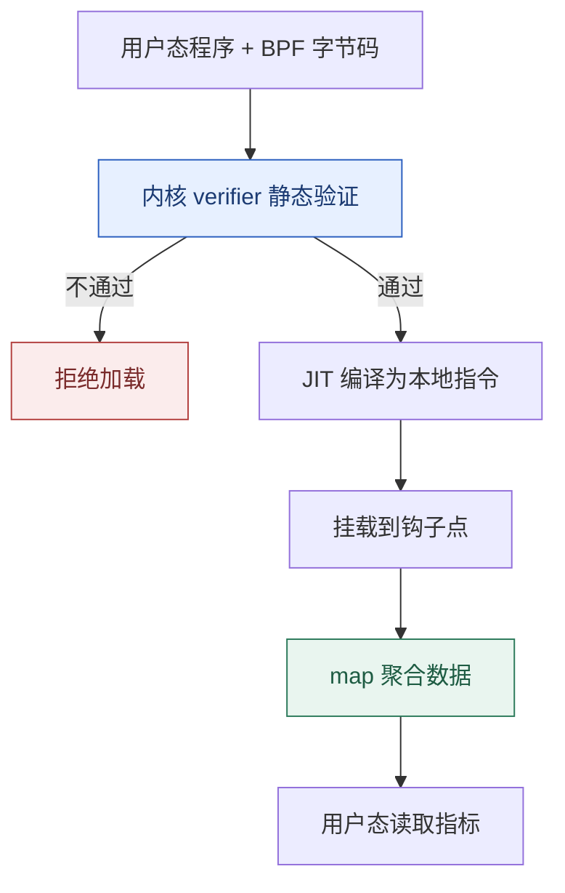

# 网络栈与 eBPF：从 sk_buff 到可编程内核

**结论先行**：网络问题难查，往往是因为把「应用慢」「连接失败」「丢包」「延迟抖动」当成一件事。正确做法是**先把收包路径切成五段，逐段找计数器**。而 eBPF 的价值在于：不改内核源码、不加载任意内核模块，就能在这些路径上挂一段**经过 verifier 静态验证**的小程序，把内核状态直接聚合成指标。

本篇是「Linux 原理系列」第 05 篇，接续[第 01 篇系统调用](/posts/2026-11-05-linux-os-01-kernel-syscall/)与[第 02 篇调度状态机](/posts/2026-11-05-linux-os-02-process-scheduler/)（软中断与进程争抢 CPU 直接相关）。

## 一、一次收包的五段路径


`sk_buff`（简称 skb）是内核里承载一个数据包的元数据结构，各层协议头通过指针偏移叠加，尽量避免复制。`NAPI` 在高负载时从「每包一次中断」切换为轮询，是防止中断风暴的关键机制。

每一段都有对应的观测入口：

| 段 | 看什么 | 命令 |
| :--- | :--- | :--- |
| 网卡 / 驱动 | 硬件丢包、CRC 错误、ring 溢出 | `ethtool -S eth0`、`ip -s link` |
| 软中断 | 每 CPU 处理时间挤压与丢包 | `cat /proc/net/softnet_stat`、`mpstat -P ALL 1` 的 `%soft` |
| 协议栈 | 重传、乱序、连接状态 | `nstat -az`、`netstat -s`、`ss -s` |
| socket | 单连接 RTT、拥塞窗口、收发队列 | `ss -tinp`、`ss -m` |
| 应用 | 读是否及时、缓冲区是否堆积 | `strace -e trace=read,recvfrom -p <pid>`、`pidstat -d 1` |

`/proc/net/softnet_stat` 每行一个 CPU，第二列是**因 netdev backlog 队列满而丢弃的包数**，第三列是 `time_squeeze`（一次软中断没处理完预算的次数）。这两列持续增长，通常说明软中断处理跟不上或者 CPU 被限流——容器场景下要先看[第 06 篇 cgroup 的 CPU 配额](/posts/2026-11-05-linux-os-06-cgroup-v2/)。

## 二、从现象到计数器

```bash
ss -tin                             # 每条 TCP 连接：cwnd、rtt、rto、重传、pacing
ss -s                               # 汇总：各状态连接数
nstat -az | grep -E "TcpRetransSegs|TcpExtListenDrops|TcpExtTCPBacklogDrop"
sar -n DEV,ETCP 1                   # 每秒包量、错误、主动/被动连接、重传
ethtool -S eth0 | grep -Ei "drop|miss|error|no_buf"
cat /proc/net/softnet_stat | head -4
tcpdump -i eth0 -nn -c 200 'tcp[tcpflags] & tcp-syn != 0'
```

| 现象 | 优先怀疑 | 证据 |
| :--- | :--- | :--- |
| 偶发连接超时 | 监听队列溢出 / conntrack 满 | `TcpExtListenDrops`、`dmesg` 里 `nf_conntrack: table full`、`ss -lnt` 的 `Send-Q` |
| 吞吐上不去但延迟低 | 窗口、BDP、拥塞控制 | `ss -tin` 的 `cwnd`/`rtt`、`sysctl net.ipv4.tcp_congestion_control` |
| 丢包、PPS 高 | ring 满、软中断预算不足 | `ethtool -S` 的 `rx_missed`、`softnet_stat` 第二列 |
| 单核 100% softirq | RPS/RSS 未生效或队列绑核不均 | `mpstat -P ALL 1`、`cat /proc/interrupts` |
| 应用读到的数据迟 | socket 接收队列堆积、应用调度延迟 | `ss -m` 的 `skmem`、`pidstat -w 1` |

**别一上来调 `sysctl`**。TCP 缓冲区、拥塞控制算法、`tcp_tw_reuse` 这类参数的默认值已经过广泛验证；没有 `ss` / `nstat` / 抓包证据就改内核参数，通常只是把问题挪到别处。

netfilter 这条链也值得单独记住：`iptables` / `nftables` 规则、conntrack 表、TC qdisc 都挂在 skb 经过的路径上。规则上万条、conntrack 表打满，都会表现为「网络偶发不通」而非「CPU 高」。

## 三、eBPF：为什么它比内核模块更适合观测

eBPF 是一个在内核里运行的受限虚拟机。用户态把字节码加载进内核，内核先跑 **verifier** 做静态检查，通过后 JIT 编译成本地代码，挂到指定钩子点执行。



| 组成 | 作用 |
| :--- | :--- |
| verifier | 保证程序必然终止、无越界访问、无未初始化读取；这是 eBPF 敢于跑在内核态的安全根基 |
| map | 内核与用户态共享的键值存储，用于在内核侧**聚合**而不是把每个事件都传回用户态 |
| 程序类型 | kprobe / tracepoint / fentry、XDP、TC、cgroup、socket filter、BPF LSM 等，各自可访问的数据不同 |
| CO-RE + libbpf | 一次编译跨内核版本运行，依赖 BTF 类型信息；避免为每个内核版本重编译 |
| 助手函数 | 受限白名单，不能任意调用内核函数 |

常见的程序类型与位置：

- **tracepoint / kprobe**：观测系统调用、调度、文件打开，开销低、适合统计。
- **XDP**：在驱动层、skb 分配之前处理包，可做早丢弃（DDoS 防护），`XDP_DROP` 的代价远低于进协议栈后再丢。
- **TC / cgroup skb**：做流量整形、按 cgroup 计费与策略。
- **BPF LSM**：实现强制访问控制，与 SELinux / AppArmor 并列，Landlock 则是另一条面向非特权进程的路径。

```bash
# 需要对应工具包与权限（bpftrace / bpftool，多数环境需 root）
bpftrace -e 'tracepoint:syscalls:sys_enter_openat { @[comm] = count(); }'
bpftrace -e 'tracepoint:block:block_rq_issue { @bytes = hist(args->bytes); }'
bpftool prog list
bpftool map list
cat /proc/sys/kernel/unprivileged_bpf_disabled
```

**能力边界要说清**：verifier 保证的是内存与终止安全性，不保证业务逻辑正确，也不提供实时性保证；加载特权程序通常需要 `CAP_BPF` / `CAP_SYS_ADMIN`，因此 eBPF 本身也是需要纳入权限审计的接口。生产环境应限制谁能加载、程序挂在哪、map 占多少内存。

## 四、把可观测性串起来

传统的 `/proc` 计数器是**内核预先定义好的聚合**，eBPF 允许你按自己的维度（进程、cgroup、_container_、TCP 四元组、延迟直方图）重新聚合。两者是互补关系：先用 `ss` / `nstat` / `softnet_stat` 判断哪一段出了问题，再用 eBPF 定位到具体进程或具体函数；这比一上来挂几十个 kprobe 要高效得多。

配套的[第 08 篇性能观测](/posts/2026-11-05-linux-os-08-performance-observability/)会把这套「先分层、再定界、后下钻」整理成可复用的 USE 判别链；[第 00 篇全景报告](/posts/2026-11-05-linux-os-00-panorama/)则给出 eBPF 在主线内核的成熟度与证据等级。

## 系列导航

- [00 · Linux 操作系统全景：可核查的深度研究报告](/posts/2026-11-05-linux-os-00-panorama/)
- [01 · Linux 到底是什么：内核、发行版与一次系统调用的旅程](/posts/2026-11-05-linux-os-01-kernel-syscall/)
- [02 · 进程与调度：从 fork 到 EEVDF](/posts/2026-11-05-linux-os-02-process-scheduler/)
- [03 · 内存管理：虚拟内存、页表与 OOM](/posts/2026-11-05-linux-os-03-memory-management/)
- [04 · VFS 与文件系统：一次写盘的完整路径](/posts/2026-11-05-linux-os-04-vfs-filesystems/)
- [05 · 网络栈与 eBPF：从 sk_buff 到可编程内核](/posts/2026-11-05-linux-os-05-network-ebpf/)（本篇）
- [06 · cgroup v2 与容器资源边界](/posts/2026-11-05-linux-os-06-cgroup-v2/)
- [07 · 启动流程与内核开发：从 UEFI 到第一个补丁](/posts/2026-11-05-linux-os-07-boot-and-kernel-dev/)
- [08 · 性能观测与调优：USE 方法与四层瓶颈判别](/posts/2026-11-05-linux-os-08-performance-observability/)
- 基础篇：[文件权限与特权提升](/posts/2026-09-14-linux-permissions-security/) · [信号机制与守护进程](/posts/2026-09-14-linux-signals/) · [网络命名空间与容器隔离](/posts/2026-09-14-linux-network-namespaces/) · [systemd 与自动化运维](/posts/2026-09-14-linux-systemd-ops/)

---

*eBPF 程序类型、助手函数与所需权限随内核版本变化；文中命令需 `bpftrace` / `bpftool` 与相应权限，请在测试环境验证后再用于生产。*
