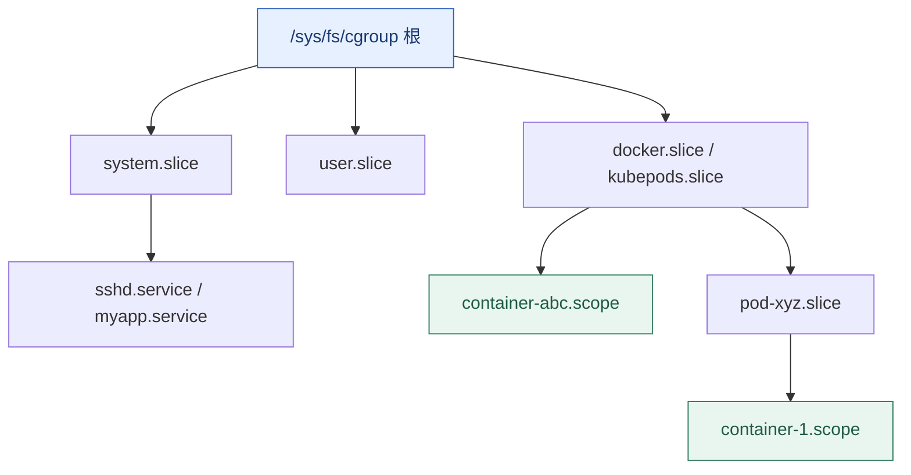

# cgroup v2 与容器资源边界

**结论先行**：容器隔离靠两半——**namespace 决定进程「看得见什么」，cgroup 决定「能用多少」**。cgroup v2 用一棵统一层级树取代 v1 的多套独立挂载，语义更一致，但也带来一条最常踩的规则：**控制器必须自上而下逐级启用，且启用控制器的层级不能再直接放进程**。容器里的「4 核却跑不满」「宿主机内存充足但进程被 OOM kill」，几乎都能在这棵树上找到答案。

本篇是「Linux 原理系列」第 06 篇，承接[第 02 篇调度](/posts/2026-11-05-linux-os-02-process-scheduler/)与[第 03 篇内存 OOM](/posts/2026-11-05-linux-os-03-memory-management/)。

## 一、统一层级与两条硬规则



```bash
mount -t cgroup2                     # 现代发行版由 systemd 挂载到 /sys/fs/cgroup
cat /sys/fs/cgroup/cgroup.controllers        # 根上可用的控制器
cat cgroup.subtree_control                   # 该层已向下启用的控制器
cat cgroup.procs                             # 该层直接包含的进程
```

- **规则一（top-down）**：父层没在 `cgroup.subtree_control` 里写 `+cpu`，子层就看不到 `cpu.max`。启用方法是向父层写入：`echo "+cpu +memory +io +pids" > /sys/fs/cgroup/cgroup.subtree_control`。
- **规则二（no-internal-process）**：一旦某层启用了控制器向下分发，该层就不能再直接放进程，只能放子 cgroup。这解释了为什么 `systemd` 把所有服务都放进 `.service` / `.scope`，而根层几乎为空。

v1 里 cpu、memory、blkio 各自独立挂载、进程可以分属不同层级，导致「同一个容器在不同控制器里口径不一致」；v2 一个进程只属于一个 cgroup 节点，这是最重要的语义改进。

## 二、四个最常用的控制器

| 控制器 | 关键文件 | 语义 |
| :--- | :--- | :--- |
| cpu | `cpu.max`、`cpu.weight`、`cpu.stat` | `cpu.max` 形如 `200000 100000`：每 100 ms 周期最多用 200 ms CPU（= 2 核）；`max 100000` 表示不设上限。`weight` 是竞争时的相对权重（1–10000，默认 100） |
| memory | `memory.current`、`memory.max`、`memory.high`、`memory.stat`、`memory.events` | `max` 是硬限；`high` 是软限，超了先节流回收而不直接 OOM；`events` 里的 `oom_kill` 是判断容器 OOM 的关键计数 |
| io | `io.max`、`io.stat`、`io.weight` | 按设备限制 IOPS / 带宽；`io.stat` 看实际压力 |
| pids | `pids.max`、`pids.current` | 限制进程/线程总数，防止 fork 炸弹拖垮宿主机 |

```bash
# CPU 是否被限流（容器「有核用不上」的头号原因）
cat /sys/fs/cgroup/cpu.stat
# usage_usec ... nr_periods 1200 / nr_throttled 310 / throttled_usec 88000000
# nr_throttled 占比高 = 配额周期性用尽，延迟会呈现规律性尖刺

# 内存：区分「快满了」和「已经 OOM 过」
cat /sys/fs/cgroup/memory.current; cat /sys/fs/cgroup/memory.max
cat /sys/fs/cgroup/memory.events
cat /sys/fs/cgroup/cgroup.events

# PSI 开启时，cgroup 级压力比用量更能解释延迟
cat /sys/fs/cgroup/cpu.pressure
cat /sys/fs/cgroup/memory.pressure
```

**CPU throttling 是最反直觉的一类问题**：一个 4 核配额的容器里跑 4 个线程，微突发（burst）会在 100 ms 周期的前 20 ms 用尽配额，剩下 80 ms 全部被挂起。平均值看起来 CPU 只用了 20%，P99 延迟却非常差。判据是 `cpu.stat` 的 `nr_throttled` / `throttled_usec`，而不是 `top` 里的 CPU%。

## 三、容器运行时怎么映射过来

| 用户写法 | 大致落到 |
| :--- | :--- |
| `docker run --memory=512m` | 该容器 cgroup 的 `memory.max` |
| `docker run --cpus=2` | `cpu.max`（按周期换算），不是绑核 |
| `docker run --cpuset-cpus=0-3` | `cpuset.cpus.effective` |
| `docker run --pids-limit=200` | `pids.max` |
| Kubernetes `requests` | `cpu.weight` / `memory.min` 类的相对保障 |
| Kubernetes `limits` | `cpu.max` / `memory.max` 硬限 |

两个高频误判：

1. **容器内 `/proc/meminfo`、`free` 显示的是宿主机**（除非额外挂了 lxcfs 之类的用户态方案）。JVM、Go runtime、Nginx worker 数若按它自动推断堆大小或线程数，很容易撞上 `memory.max` 或 `pids.max`。正确做法是让运行时读取 cgroup 文件（现代 JDK 与 Go 已支持），或显式传参。
2. **宿主机内存充足 ≠ 容器不会 OOM**。[第 03 篇](/posts/2026-11-05-linux-os-03-memory-management/)讲过：限额在 cgroup 层，OOM kill 由该层触发，`memory.events` 会记录，`dmesg` 也可能显示 cgroup 路径。

## 四、systemd 才是这棵树的管理者

现代发行版上不要绕过 systemd 直接往 `/sys/fs/cgroup` 写 `cgroup.procs`——它会和 systemd 的层级视图冲突，且重启即失效。用它的原生接口：

```bash
systemd-run --scope -p MemoryMax=512M -p CPUQuota=200% ./batch-job.sh
systemctl set-property myapp.service MemoryMax=1G TasksMax=200
systemctl show myapp.service -p MemoryMax -p CPUQuotaPerSecUSec -p TasksMax
systemd-cgtop                     # 按 cgroup 看资源占用
systemd-cgls                      # 层级树
```

关于 service / timer / slice 的用法与边界，本站已有专文：[systemd 与自动化运维](/posts/2026-09-14-linux-systemd-ops/)。

## 五、namespace 与 cgroup 的分工

| 能力 | 由谁提供 | 典型接口 |
| :--- | :--- | :--- |
| 看不见别的进程 | PID namespace | `/proc` 只显示本 ns 进程 |
| 看不见别的挂载点 | mount namespace | `/proc/self/mountinfo` |
| 看不见别的网卡 | network namespace | `ip netns`、`nsenter -n` |
| 用不了太多 CPU / 内存 | cgroup | `cpu.max`、`memory.max` |
| 权限被收敛 | capabilities / seccomp / LSM | `capsh --print`、seccomp profile |

一个实用推论：**`nproc` 与「可用 CPU 配额」是两回事**。前者看的是 CPU 亲和性掩码，后者由 `cpu.max` 决定；两者不一致时，应用按 `nproc` 起满线程池只会加重 throttling。网络 namespace 的机制细节见[网络命名空间与容器隔离](/posts/2026-09-14-linux-network-namespaces/)。

## 六、排查清单

```bash
# 1. 确认自己是哪一层
cat /proc/self/cgroup
cat /sys/fs/cgroup/cgroup.controllers

# 2. CPU：是否被限流
cat /sys/fs/cgroup/cpu.stat; cat /sys/fs/cgroup/cpu.max

# 3. 内存：是否撞限、是否发生过 OOM
cat /sys/fs/cgroup/memory.events; cat /sys/fs/cgroup/memory.max

# 4. 进程数：是否撞 pids.max
cat /sys/fs/cgroup/pids.current; cat /sys/fs/cgroup/pids.max

# 5. 压力：PSI（内核启用时）
cat /sys/fs/cgroup/cpu.pressure; cat /sys/fs/cgroup/memory.pressure
```

把这五步放在登录容器后的第一分钟，能省掉大量「是不是内核有 bug」的无谓猜测。更完整的分层判别见[第 08 篇性能观测](/posts/2026-11-05-linux-os-08-performance-observability/)。

## 系列导航

- [00 · Linux 操作系统全景：可核查的深度研究报告](/posts/2026-11-05-linux-os-00-panorama/)
- [01 · Linux 到底是什么：内核、发行版与一次系统调用的旅程](/posts/2026-11-05-linux-os-01-kernel-syscall/)
- [02 · 进程与调度：从 fork 到 EEVDF](/posts/2026-11-05-linux-os-02-process-scheduler/)
- [03 · 内存管理：虚拟内存、页表与 OOM](/posts/2026-11-05-linux-os-03-memory-management/)
- [04 · VFS 与文件系统：一次写盘的完整路径](/posts/2026-11-05-linux-os-04-vfs-filesystems/)
- [05 · 网络栈与 eBPF：从 sk_buff 到可编程内核](/posts/2026-11-05-linux-os-05-network-ebpf/)
- [06 · cgroup v2 与容器资源边界](/posts/2026-11-05-linux-os-06-cgroup-v2/)（本篇）
- [07 · 启动流程与内核开发：从 UEFI 到第一个补丁](/posts/2026-11-05-linux-os-07-boot-and-kernel-dev/)
- [08 · 性能观测与调优：USE 方法与四层瓶颈判别](/posts/2026-11-05-linux-os-08-performance-observability/)
- 基础篇：[文件权限与特权提升](/posts/2026-09-14-linux-permissions-security/) · [信号机制与守护进程](/posts/2026-09-14-linux-signals/) · [网络命名空间与容器隔离](/posts/2026-09-14-linux-network-namespaces/) · [systemd 与自动化运维](/posts/2026-09-14-linux-systemd-ops/)

---

*文件名与语义以 cgroup v2 为准；老系统可能是 v1 或 hybrid 模式，排查前先用 `mount -t cgroup2` 与 `stat -fc %T /sys/fs/cgroup` 确认。*
