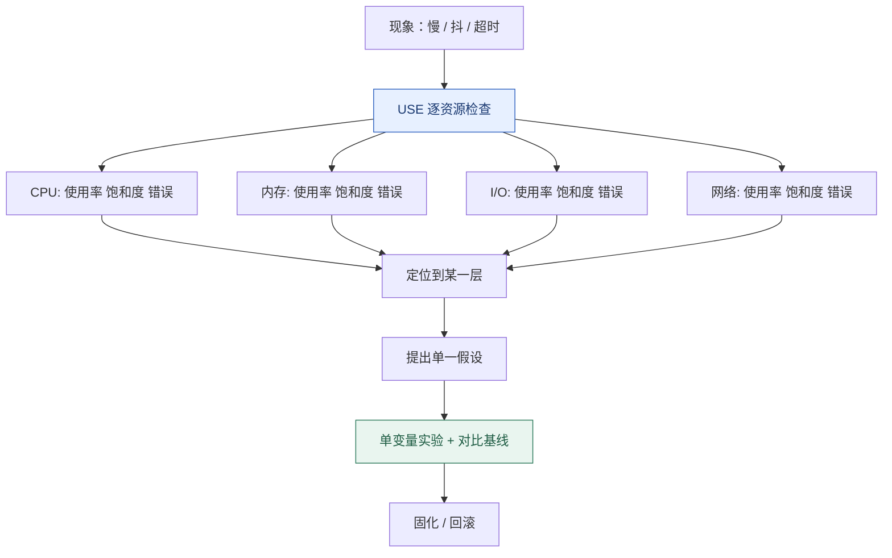

# 性能观测与调优：USE 方法与四层瓶颈判别

**结论先行**：调优不是「调参数」，是把「感觉慢」翻译成可测量的量。可复用的顺序只有一条：**测量 → 定界（哪一层资源）→ 提出假设 → 一次只改一个变量验证 → 固化并保留基线**。绝大多数线上性能事故，问题出在跳过了前两步，直接照抄一份 `sysctl` 优化清单。

本篇是「Linux 原理系列」第 08 篇（完结篇），把前面七篇的机制收束成一套可执行的排查方法。

## 一、第一分钟：先取证，别急着改

```bash
uptime                          # load average（含 R 与 D 状态任务）
dmesg -T | tail -30             # OOM、I/O 错误、驱动告警
vmstat 1 5                      # r、b、si/so、wa、us/sy/id
mpstat -P ALL 1 3               # 是否单核打满、%soft 是否异常
pidstat -urd 1 5                # 逐进程 CPU / 缺页 / I/O
free -h                         # available 而非 free
iostat -xz 1 5                  # await、aqu-sz、util、读写量
sar -n DEV 1 5                  # 网卡 PPS / 带宽 / 错误
ss -s; nstat -az | head -30     # 连接状态与协议栈计数
cat /proc/pressure/cpu /proc/pressure/memory /proc/pressure/io   # PSI
```

这十条命令覆盖 CPU、内存、块 I/O、网络、内核日志与压力指标，开销极低。**先把输出留档**，再开始任何变更；没有基线就无法判断「优化」是否真的有效。

## 二、USE 方法：每个资源问三个问题

对每一项资源分别检查 **U**（Utilization，使用率）、**S**（Saturation，饱和度 / 排队）、**E**（Errors，错误）。服务侧则常补一组 RED（Rate / Errors / Duration）或延迟分位数。



| 资源 | Utilization | Saturation | Errors |
| :--- | :--- | :--- | :--- |
| CPU | `mpstat` 的 `%usr+%sys` | `vmstat` 的 `r`、`/proc/pressure/cpu`、`cpu.stat` 的 `nr_throttled` | `mce` / `dmesg` 硬件错误 |
| 内存 | `free` 的 used / available | PSI memory、major fault、`pgscan/s`、`si/so` | OOM kill、`memory.events` |
| 块 I/O | `iostat` 的 `%util`（机械盘） | `aqu-sz`、`await`、PSI io | `dmesg` 的 I/O error、文件系统只读 |
| 网络 | `sar -n DEV` 的带宽 / PPS | `softnet_stat` 丢包列、`ss` 队列、`nstat` 重传 | `ethtool -S` 的 error/drop、CRC |

**USE 的价值在于防漏**：CPU 使用率不高但 `r` 队列很长（饱和度问题）、带宽没跑满但重传很高（错误问题），这两类情况用「看使用率」的思路一定会被漏掉。

## 三、四层判别链

| 现象 | 首选判据 | 指向 | 常见误判 |
| :--- | :--- | :--- | :--- |
| load 高、CPU 空闲 | `vmstat` 的 `b`、`ps` 里 D 状态 | I/O 或内核等待路径，不是 CPU 不够 | 直接加 CPU 核数 |
| `%wait` 高、延迟有周期性尖刺 | `pidstat -u` 的 `%wait`、`cpu.stat` 的 `nr_throttled` | cgroup CPU 配额用尽 | 以为「平均 CPU 才 20% 所以没问题」 |
| `available` 小、PSI 低 | `/proc/meminfo` 的 buff/cache | page cache 占满，属正常 | 清缓存、盲目关 swap |
| 容器进程被杀 | `memory.events` 的 `oom_kill`、`dmesg -T` | cgroup 层 OOM | 查宿主机 `free`（还有几十 GB） |
| `await` 高、吞吐不高 | `iostat -xz` 的 `aqu-sz`、`blktrace`/eBPF 下钻 | 设备饱和或队列过深 | 只看 `%util`，NVMe 上会误读 |
| P99 抖动、丢包 | `/proc/net/softnet_stat`、`ethtool -S`、重传计数 | 软中断 / 驱动队列 / 网络 | 直接调 TCP 缓冲区参数 |

对应的机制细节分别在本系列：[02 调度](/posts/2026-11-05-linux-os-02-process-scheduler/)（R/D 状态与 `%wait`）、[03 内存](/posts/2026-11-05-linux-os-03-memory-management/)（PSI 与 OOM）、[04 文件系统](/posts/2026-11-05-linux-os-04-vfs-filesystems/)（page cache 与回写）、[05 网络](/posts/2026-11-05-linux-os-05-network-ebpf/)（softnet_stat 与重传）、[06 cgroup](/posts/2026-11-05-linux-os-06-cgroup-v2/)（throttling 与限额）。

## 四、工具层次：从计数器到动态追踪

| 层次 | 代表 | 开销 | 适合 |
| :--- | :--- | :--- | :--- |
| 静态计数器 | `/proc`、`/sys`、`sar`、`vmstat` | 几乎为零 | 常开、告警、第一分钟 |
| 采样剖析 | `perf top`、`perf record`、火焰图 | 低到中（看采样频率） | 找 CPU 热点与调用栈 |
| 动态追踪 | kprobe / tracepoint / bpftrace / eBPF | 中，取决于事件频率 | 按自定义维度下钻、直方图 |
| 全链路追踪 | 应用侧 OpenTelemetry + 内核侧 eBPF | 中到高 | 把内核等待与应用请求关联 |

生产环境使用动态追踪的两条纪律：**先在内核侧聚合（map / 直方图），不要把每个事件都传回用户态**；**限制挂钩点与采样时长**，事件频率高的钩子（如每次网络包）必须限流。观测工具本身也会消耗 CPU 与内存，排查「观测开着更慢」时要把它算进去。

## 五、一次完整的推理示例

现象：某 API 的 P99 每隔几十秒出现一次尖刺，平均 CPU 仅 20%，`free` 显示内存充足。

1. **测量**：`uptime` load 偏高但 `mpstat` 显示 CPU 大部分空闲 → 排除 CPU 算力不足。
2. **定界**：`vmstat 1` 的 `b` 列周期性不为零、`ps` 出现 D 状态 → 指向 I/O 等待；`iostat -xz 1` 显示 `await` 与 `aqu-sz` 同步尖峰。
3. **假设**：批量任务的写盘与在线请求抢同一设备；或容器 `io.max` 被限流。
4. **验证**：`cat /sys/fs/cgroup/io.stat`、把批量任务单独限流后对比 P99 与 `await`，一次只改一个变量。
5. **固化**：把限流写成 systemd/cgroup 配置并记录基线，保留回滚路径。

注意整条链里没有一步是「改内核参数」。**先找到被争抢的资源，再决定是隔离、限流还是扩容**——这才是调优。

## 六、六条原则

1. **先测量后动手**，保留可对比的基线与变更记录。
2. **先改应用再改系统**：一次不必要的 `read`、没有索引的查询、缺缓冲的写，收益通常远大于 `sysctl`。
3. **一次只改一个变量**，否则无法归因。
4. **区分平均与尾延迟**：配额、回收、队列都会让 P99 恶化而平均值不动。
5. **不要复制「优化清单」**：内核默认值面向通用负载，很多参数在 SSD/NVMe、容器与云盘时代已经换了语境。
6. **明确回滚路径**：改内核参数、换调度器、升级内核都要能在几分钟内退回。

## 系列小结

从 [00 全景报告](/posts/2026-11-05-linux-os-00-panorama/)的产业与治理视角，到 [01 系统调用](/posts/2026-11-05-linux-os-01-kernel-syscall/)建立的边界感，再到调度、内存、文件系统、网络、cgroup、启动与内核开发，最后收束到本篇的观测方法——这条路径刻意按「**先在内核里发生了什么，再看用户能观察到什么**」组织。

如果要把系列真正变成手感，建议在一台可随便重启的测试机上做四组实验：`strace -c` 数一次命令的系统调用、`stress-ng` 造 CPU 与内存压力观察 PSI、用 `systemd-run` 给进程套上 `MemoryMax` 触发 cgroup OOM、用 `bpftrace` 画一张块 I/O 延迟直方图。四组做完，本系列的大部分概念都会落到具体数字上。

## 系列导航

- [00 · Linux 操作系统全景：可核查的深度研究报告](/posts/2026-11-05-linux-os-00-panorama/)
- [01 · Linux 到底是什么：内核、发行版与一次系统调用的旅程](/posts/2026-11-05-linux-os-01-kernel-syscall/)
- [02 · 进程与调度：从 fork 到 EEVDF](/posts/2026-11-05-linux-os-02-process-scheduler/)
- [03 · 内存管理：虚拟内存、页表与 OOM](/posts/2026-11-05-linux-os-03-memory-management/)
- [04 · VFS 与文件系统：一次写盘的完整路径](/posts/2026-11-05-linux-os-04-vfs-filesystems/)
- [05 · 网络栈与 eBPF：从 sk_buff 到可编程内核](/posts/2026-11-05-linux-os-05-network-ebpf/)
- [06 · cgroup v2 与容器资源边界](/posts/2026-11-05-linux-os-06-cgroup-v2/)
- [07 · 启动流程与内核开发：从 UEFI 到第一个补丁](/posts/2026-11-05-linux-os-07-boot-and-kernel-dev/)
- [08 · 性能观测与调优：USE 方法与四层瓶颈判别](/posts/2026-11-05-linux-os-08-performance-observability/)（本篇）
- 基础篇：[文件权限与特权提升](/posts/2026-09-14-linux-permissions-security/) · [信号机制与守护进程](/posts/2026-09-14-linux-signals/) · [网络命名空间与容器隔离](/posts/2026-09-14-linux-network-namespaces/) · [systemd 与自动化运维](/posts/2026-09-14-linux-systemd-ops/)

---

*本文命令以通用 GNU/Linux 发行版与 cgroup v2 为准；`perf` / eBPF 需要相应权限与内核配置，生产使用前请评估开销并先在测试环境验证。*
